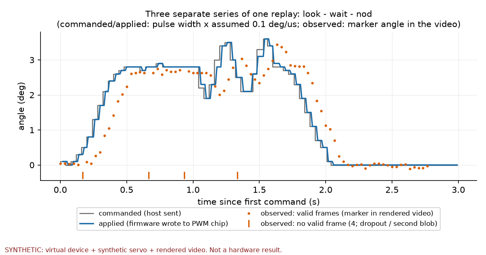
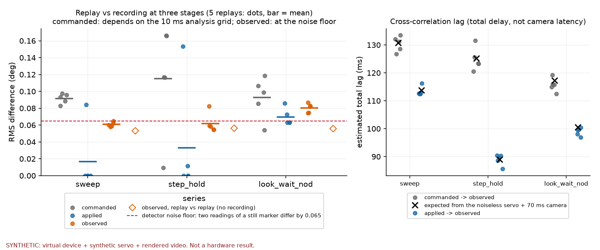

# motion-io-lab

Record a person's input, replay it to a servo (or to a virtual one), and observe what actually moved. This repository is the software side of that loop: a trial log with three separate streams, a guarded firmware protocol, a recorder and player, a camera observation path, and an analysis that keeps commanded, firmware-applied and camera-observed series apart.
**Everything in the figures and in `reference_results/` is synthetic (virtual device, synthetic servo, rendered video). Nothing has been run on a real servo, a real camera or a Joy-Con yet; the steps for the servo and camera are in `docs/HARDWARE_RUN.md`, for the Joy-Con in `docs/JOYCON.md`.**

## この 1 本が答えようとしている問い（実物では未回答）

> 人の入力を記録して再生したとき、実物はどこまで同じ動きをし、違いはどこで生まれるか。

答えるために、動きが通る段を別々に記録する。

```
人の入力 → 指令（ホストが送った値） → 適用値（ファームが PWM チップへ書いた値） → 実際の動き → カメラの観測
input.jsonl   command.jsonl (set)        command.jsonl (reply)                                  observation.jsonl
```

「指令した角度」を「実測した角度」と呼ばない。適用値も位置ではない。録音と再生の差を、指令・適用値・観測の 3 段で別に出す。ただし、**段の大小がそのまま「差の生まれた場所」を教えるわけではない**（下の「読み方」と `docs/DESIGN.md` の 5）。

## 30 秒のデモ（1 コマンド、合成）

```bash
python -m motion_io_lab demo --out outputs/demo
```

約 15〜30 秒。仮想デバイスに 3 つの短い動作（`sweep` / `step_hold` / `look_wait_nod`）を記録し、同じ記録を 5 回再生し、サーボの動きを動画に描いて実際の検出器で読み、3 系列を整列して比べる。ついでに、切断→再開、再送した古い行、重複 seq、範囲外、期限切れ、締切方式と sleep 後方式の時刻の守り方も回す。出力は `outputs/demo/` の `report.md`、`summary.json`、試行ごとのログ、`run_manifest.json`。




デモの数値（**すべて合成**。`reference_results/demo_summary.json`、seed 7 の 1 回の例。8 つの seed の範囲は `reference_results/seed_table.json`）:

| 動作 | 録音と再生の差 RMS（指令 / 適用値 / 観測, deg） | 5 回の観測のばらつき SD (deg) | 指令→観測の総遅れ (ms) |
|---|---|---|---|
| sweep | 0.09 / 0.02 / 0.06 | 0.05 | 130 |
| step_hold | 0.11 / 0.03 / 0.06 | 0.05 | 125 |
| look_wait_nod | 0.09 / 0.07 / 0.08 | 0.05 | 116 |

読み方（合成の数値で言えるのはここまで）:

- 描画した動画の中の動かないマーカーを同じ経路で読んだ角度の SD は 0.046°（合成。独立な 2 回の読みの差は 0.065°）。**観測の段（0.06〜0.08°）も、5 回のばらつき SD（0.05°）も、この検出器の雑音の床の高さ**で、サーボの差は見えていない。
- 指令の段は、送信時刻の約 1 ms のずれを 10 ms の格子で見た量。同じサンプルどうしで比べると 0。適用値の段は、`sweep` と `step_hold` では再生ごとに 0 か 0.1° 前後に偏り、`look_wait_nod` では 0.06〜0.09° にほぼ連続して乗る。
- 8 seed では、同じ表の観測の段が 0.055〜0.100°、適用値の段が 0.001〜0.121° と動く。3 桁目は seed の選び方で変わる。
- 総遅れは、指令→観測が 116〜130 ms（seed 7。8 seed では 116〜131 ms）、適用値→観測が 89〜113 ms（seed 7。8 seed では 85〜113 ms）。2 つは別の区間の量なので、まとめて 1 つの幅にはしない。カメラ遅れ（仮定は 70 ms）の推定ではない。
- 雑音源を 1 つずつ切る実験（`scripts/ablation.py`）で、送信時刻のゆらぎ・開始状態・ゲイン変動・マーカーの揺れがそれぞれどの段を動かすかを見た。仮定の全部は `docs/DESIGN.md` の 4。

これは「道具と指標が動く」ことを示す数値で、実物のサーボやカメラの数字ではない。主張の一覧と、言えないことは `docs/CLAIMS.md`。テストが何を拾えて何を拾えていないかは `docs/MUTATION_CHECK.md`。

## 入力と出力

用語（スルー、epoch、ラッチなど）は `docs/DESIGN.md` の冒頭にまとめた。

| 入力 | 出力 |
|---|---|
| キーボード、スマホブラウザのタッチパッド（127.0.0.1、トークン必須）、台本、Joy-Con（標準入力、未検証） | `input.jsonl`（人が何をしたか。ブラウザの時計とホスト受信時刻は別の列） |
| 整形（範囲・スルー）した指令と、デバイスの返事 | `command.jsonl`（`desired_pulse_us` と `commanded_pulse_us`、`REJECTED` / `ACCEPTED_NOT_EXECUTED` / `EXECUTED`、`STATUS`） |
| カメラまたは動画ファイル | `observation.jsonl`（マーカーの角度。欠測は理由つきで値は null。露光時刻は null） |
| 試行ログ一式 | `summarize-session`、`analyze`、`prepare-dataset`（遷移 NPZ。別の repo の学習に渡すための出口で、この repo では学習しない） |

主なコマンド（すべて `python -m motion_io_lab <名前>`、`--help` あり。試行や出力のフォルダを作るコマンド（`demo` `record` `play` `observe` `camera-probe` `probe` `console`）は、そこへ `run_manifest.json` を書く。単一ファイルを出す `calibrate` `export-motion` `summarize-session` と、`analyze` `compare-reference` `validate` は書かない。`prepare-dataset convert` は自分の `.manifest.json` を書く）:

| コマンド | 内容 |
|---|---|
| `demo` | 上のデモ |
| `record` | 入力を記録。**既定の対象は `dry`（何も送らない）**。`--target loopback` で仮想デバイス、`--target hardware` は実機（下記の鍵が要る） |
| `play` | 記録した試行または動作ファイルを再生。同じく既定は `dry`。`--start-ms/--end-ms`、`--speed`（録音より速くしない）、`--resume` |
| `observe` / `camera-probe` | カメラ・動画の観測 / フレーム時刻の記録（装置は動かさない） |
| `analyze` / `summarize-session` / `compare-reference` | 解析、セッション集計（`--still-trials` で検出器の雑音の床）、基準との比較（一致 / 別ビルドの許容差内 / 不一致） |
| `calibrate` | 測ったパルスと角度から校正（版はハッシュ） |
| `validate` / `schema` | ログの検証 / スキーマの出力 |
| `prepare-dataset` | 試行ログから遷移 CSV → NPZ（上書き拒否、行番号つきエラー）。別の repo の学習へ渡す出口 |
| `probe` / `console` | 短時間の 1 パルス / 手入力のコンソール（プロトコル v2） |
| `virtual-device` | 仮想デバイスを疑似端末で提供 |

## 何が動いていて、何が未検証か

| | 状態 |
|---|---|
| 試行ログ、プロトコル v2、仮想デバイス、記録器、再生器、観測、解析、デモ、図 | 実装済み。Mac 上のテストで確認（`docs/STATUS.md`）。合成データ |
| ファームの論理（コンパイルした同じ核をホストで実行） | テストで確認。**ESP32 上の実行ではない** |
| ファームの `arduino-cli` コンパイル（`esp32:esp32:XIAO_ESP32S3`） | 通る（300,121 bytes、警告 0）。書込みはしていない（`docs/FIRMWARE_BUILD.md`） |
| 実機（XIAO + PCA9685 + MG90S）での操作・保存・再生 | **未検証** |
| 実カメラでの観測、カメラ遅延、パルス→角度の校正 | **未検証**（描画動画では検出経路を確認） |
| Joy-Con の姿勢・入力 | **未検証**（プローブは書いたが、この Mac に Joy-Con は 0 台。`docs/JOYCON.md`） |
| iPhone の Safari からのタッチパッド | **未検証**（Mac 上の HTTP クライアントでサーバー側を確認。実機のブラウザは未確認） |
| ATOMS3 Lite | **未対応**（ピン割当を公式で確認できない。`docs/BOARDS.md`） |

`HARDWARE_VERIFIED` は `false` のまま公開している。ファームは `ARM` を `REJECTED hardware_verified_false` で拒否する。実機へ向ける `--target hardware` は、`--port`、`--i-checked-hardware`、端末での `ARM <port>` の文字入力の 3 つが全部要る（`--i-checked-hardware` は自己申告で、安全の認証ではない）。非常停止はソフトの外（電源の線）にある前提で、ソフトの停止はそれを置き換えない。

## 再現手順

検証した版: Python 3.11.7（macOS 26.5、arm64）、numpy 2.4.6、opencv-python 5.0.0.93、pyserial 3.5、matplotlib 3.11.2（`requirements-lock.txt`）。一番古い版の組 `requirements-lowest.txt`（numpy 2.0.2、opencv-python 4.14.0.94、matplotlib 3.9.4）でも全テストが通り、デモが基準と一致した。**opencv-python 4.9 は対応外**（mp4 の往復で角度の読みが変わり、デモの数字が動く）。Python 3.12 の結果は `docs/STATUS.md`。数字を引くときは版（この lock）を添える。

```bash
python3 -m venv .venv && . .venv/bin/activate
python -m pip install -r requirements-lock.txt -r requirements-test-lock.txt
python -m pip install --no-deps -e .
python -m pytest                                   # 約 1〜2 分（334 件）
python -m motion_io_lab demo --out outputs/demo
python -m motion_io_lab compare-reference --summary outputs/demo/summary.json
python scripts/make_figures.py --demo outputs/demo --out outputs/figures
```

空のフォルダへ clone してここまでを通す検査: `scripts/verify_fresh_clone.sh`（スキップされたテストがあれば失敗にする。C++ コンパイラが無いと、ファームの核との一致の検査（`docs/CLAIMS.md` C09）は走らない）。`LOCK=lowest` で一番古い版の組も回せる。`run_manifest.json` の `output_sha256` は整合性の記録で、2 回の実行が同じだった証拠ではない（ログは実行時刻を含む）。ファームのコンパイル確認は `docs/FIRMWARE_BUILD.md`。実機での手順は `docs/HARDWARE_RUN.md`。

## 設計判断（詳細は `docs/DESIGN.md`）

- 入力・指令・観測を別ファイルにし、全行に単位・時計・出どころを持たせる。露光時刻は分からなければ null（受信時刻で埋めない）。
- 再接続ごとに変わる epoch、受信側の時計で測る期限、重複は無害に確認応答、古い・別世代・範囲外は fault を立てずに拒否。
- ファームの状態機械を Arduino から切り離した 1 つのヘッダにして、仮想デバイスと行ごとに一致するかをテストする。
- 再生はホストの単調時計の締切方式。遅れた指令は送らない。自動では再開しない。
- 欠測・複数候補は値を null にして理由を残す（0 で埋めない）。

## 限界

- 合成の数値は、仮定したサーボ・カメラの性質（`docs/DESIGN.md` の 4）の下での値。実物の精度・遅延・成功率ではない。
- 動画ファイルの時間軸を指令の時間軸に重ねる位置は仮定（`--media-offset-ms`）。相互相関の遅れは**総遅れ**で、カメラ遅延ではない。
- 観測の無効フレーム（欠測・2 個目の点）は、解析の格子では前後の有効フレームの間の直線で埋めて指標に入れる（120 ms を超える穴は NaN）。埋めた格子点の割合は `observation_bridged_fraction` に出す（デモで 6〜13 %）。
- 5 回の再生のばらつき（SD）は、動かないマーカーの SD（検出器の雑音の床）より大きくなって初めてサーボの再現性として読める。n = 5 の SD の相対誤差は約 35 %。
- 1 軸、パルス幅 1450〜1550 us（約 ±50 us）、スルー 500 us/s に限定。2 軸は未対応。
- ファームの `float` の丸めや I2C の挙動は ESP32 で確かめていない。`ALL_LED_OFF_H` の修正はデータシートに基づくコード上の修正で、オシロでの確認はまだ。
- 非常停止の接点定格・配線・復帰条件は、自分で現物の資料を見て確認する項目として残している。

## 関連

記録と再生の汎用の仕組みには ROS 2 の rosbag2、遠隔操作の記録をデータセットにする LeRobot などがある。この repo はそれらの代わりではなく、指令・適用値・観測を別のログに分けて、再現の差を段ごとに見る小さな実験（`docs/DESIGN.md` の 7）。目的は学習ではなく、`prepare-dataset` は遷移データを別の repo の学習に渡すための出口。

次の 4 本を同時に公開している: [latency-aware-vision](https://github.com/hocky0301/latency-aware-vision)、[adaptive-motion-lab](https://github.com/hocky0301/adaptive-motion-lab)、[motion-authoring-studio](https://github.com/hocky0301/motion-authoring-studio)、[zenn-research-companions](https://github.com/hocky0301/zenn-research-companions)。どれも単独で動き、お互いを import しない。共有するのはファイル形式だけ。

- motion-authoring-studio の出力は、そのままは再生できない。`export --format player-motion-v1 --calibration <自分で測った較正ファイル>` で `pulse_us` の行にしたものを、この repo の `play --motion` が `motion-v1` として読む。
- この repo の試行ログは、そのままは adaptive-motion-lab の入力にならない。`prepare-dataset` の CSV は 10 列、adaptive-motion-lab の必須は 16 列で、列名も違う。対応表はまだ書いていない。

## 実機の操作について

実機に向ける操作は、自分が現物の前にいるときだけ行う。スクリプトや自動実行からは行わない。無保証で、機械や人への事故は使う人の責任。製品名・社名は各社の商標で、各社との関係はない。

## 権利

閲覧用に公開しています。利用は許可制です。詳細は `RIGHTS.md`。利用許諾の相談は GitHub の Issue で。
